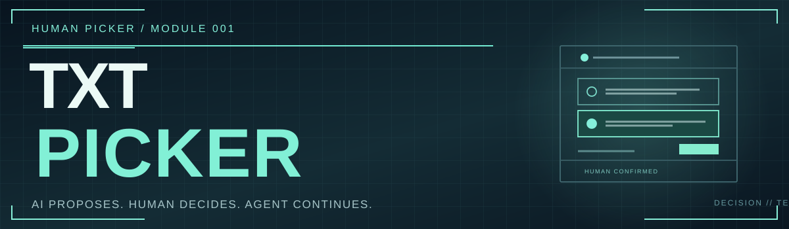

<div align="center">
  

  # txt-picker

  **A Human-in-the-Loop Text Decision Renderer for AI Agents.**

  `VUE 3` · `WEB-FIRST` · `TEXT DECISIONS` · `HUMAN-IN-THE-LOOP`

  **AI proposes. Human decides. Agent continues.**
</div>

---

> [!IMPORTANT]
> **Initial implementation / V0.1.** A Vue 3 text picker component, a REST API adapter and a local interactive demo are included. This repository does **not** run an LLM, execute Git commands, or host its own MCP server. The shared decision service lives in [`human-picker-server`](https://github.com/human-picker/human-picker-server).

## WHY THIS EXISTS

AI can generate several correct names, commit messages, subtitles, UI strings or dialog lines. But only a human can reliably decide which one *feels right*.

**txt-picker** creates a clear boundary between AI generation and human preference. It displays 2–9 text candidates, lets the human choose and optionally edit one, then emits an explicit confirmation that a calling Agent can act on.

No silent defaults. Closing or cancelling is **not** approval.

## DECISION FLOW

```text
  Agent or script                     human-picker-server
  produces options ── POST /api/v1 ────────────┐
                                               │ SQLite / MCP / REST
                                               ▼
  ┌────────────────────── txt-picker ───────────────────────┐
  │                                                         │
  │  [01] feat(core): [KERNEL AWAKENED] 内核已苏醒             │
  │  [02] feat(core): [CORE ONLINE] 基础系统已接入            │
  │  [03] feat(core): [BASE READY] 初始化项目骨架             │
  │                                                         │
  │              SELECT  →  EDIT  →  CONFIRM                │
  └───────────────────────────┬─────────────────────────────┘
                              │
                              ▼
                   Decision saved in server
                         │            │
                  Copy result     Agent polls / waits
                         │            │
                         └──────┬─────┘
                                ▼
                           Agent continues
```

## START THE DEMO

**Requirements:** Node.js 22+ and npm.

```bash
npm install
npm run dev
```

Open **http://127.0.0.1:5175**. The demo works without a backend in **local preview mode**. Select an option, edit it and confirm.

To test the real request/confirmation cycle, start [`human-picker-server`](https://github.com/human-picker/human-picker-server) separately on **127.0.0.1:4173**, paste its access token into the demo and click **CREATE REMOTE REQUEST**. Vite proxies `/api` to that local server during development.

> [!WARNING]
> The demo does not use a remote service by default. Do not commit or share the server access token. The current integration targets the local V0.1 server and is **not** a production-ready public service.

## USE AS A VUE COMPONENT

This is a source-first library scaffold; it has **not** been published to npm. When building locally, `dist/` contains the ES module, type declarations and stylesheet.

```bash
npm run build
npm run build:demo
npm test
```

```vue
<script setup lang="ts">
import { ref } from 'vue'
import { TxtPicker } from '@human-picker/txt-picker'
import '@human-picker/txt-picker/style.css'
import type { TextDecision, ResolveTextDecision } from '@human-picker/txt-picker'

const decision = ref<TextDecision>(/* result from human-picker-server */)

async function onConfirm(result: ResolveTextDecision) {
  // POST /api/v1/decisions/:id/resolve with result.
  // Do NOT automatically execute git commit here.
}
</script>

<template>
  <TxtPicker :decision="decision" @confirm="onConfirm" @cancel="() => {}" @copy="() => {}" />
</template>
```

The component is *presentational*: it does not have a server token, perform network calls or directly modify a repository. The host handles `confirm`, `cancel` and `copy` events.

The optional `HumanPickerClient` wraps the local server REST API:

```ts
import { HumanPickerClient } from '@human-picker/txt-picker'

const picker = new HumanPickerClient({ token: process.env.HP_TOKEN! })
const decision = await picker.create({
  type: 'text',
  title: 'Choose a commit message',
  options: [
    { id: 'a', text: 'feat(core): [KERNEL AWAKENED] 系统内核已苏醒' },
    { id: 'b', text: 'feat(core): [CORE ONLINE] 系统基础骨架已建立' }
  ]
})
// Open the server inbox, then call picker.wait(decision.id) or poll picker.get(decision.id).
// Only a confirmed decision authorizes a downstream, separately permitted operation.
```

## API CONTRACT

Matches the text decision schema of `human-picker-server` V0.1:

- `type`: `text`
- `options`: 2–9 `{ id, text }` candidates, with unique IDs
- `status`: `pending`, `confirmed`, `cancelled`, `expired`
- `confirm` event: `{ option_id, text? }`; `text` is included only if edited
- `cancel` event: signals cancellation, **never** a default selection
- `copy` event: contains the text to place on the clipboard

See [`docs/PROTOCOL.md`](./docs/PROTOCOL.md) for lifecycle, compatibility and integration details.

## ROADMAP

- [x] Vue 3 text candidate renderer
- [x] Select → edit → confirm/cancel component contract
- [x] REST client compatible with human-picker-server V0.1
- [x] Standalone local demo with optional server connection
- [x] Pure selection validation tests
- [ ] Batch text review (e.g. 11 Git commit titles)
- [ ] Keyboard selection and accessibility test coverage
- [ ] Extract common Picker UI from other human-picker modules
- [ ] End-to-end browser and integration tests
- [ ] npm package publication after validation

## RELATIONSHIP TO HUMAN PICKER

| Project | Responsibility |
| --- | --- |
| [human-picker-server](https://github.com/human-picker/human-picker-server) | Shared REST, MCP, SQLite and decision lifecycle |
| **txt-picker** | Text candidate renderer and lightweight client |
| [svg-picker](https://github.com/human-picker/svg-picker) | Icon selection |
| [web-picker](https://github.com/human-picker/web-picker) | Rendered HTML variant comparison |
| [human-picker-skill](https://github.com/human-picker/human-picker-skill) | Agent skill definitions |

**License:** MIT.

---

<div align="center">
  <sub>YOU WRITE THE OPTIONS. THE HUMAN MAKES THE CALL.</sub>
</div>
